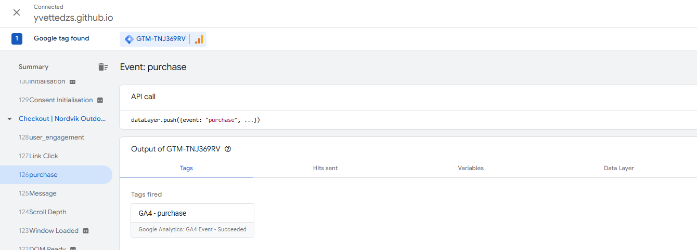
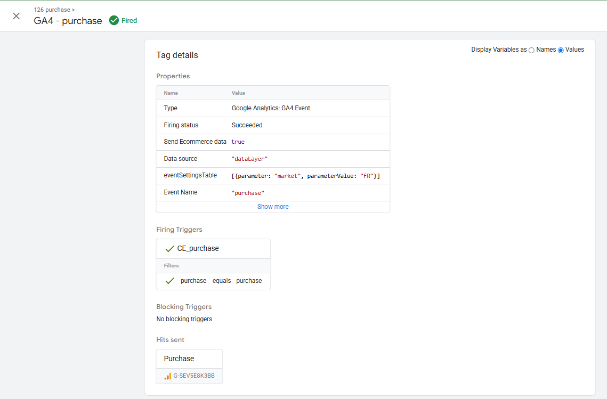
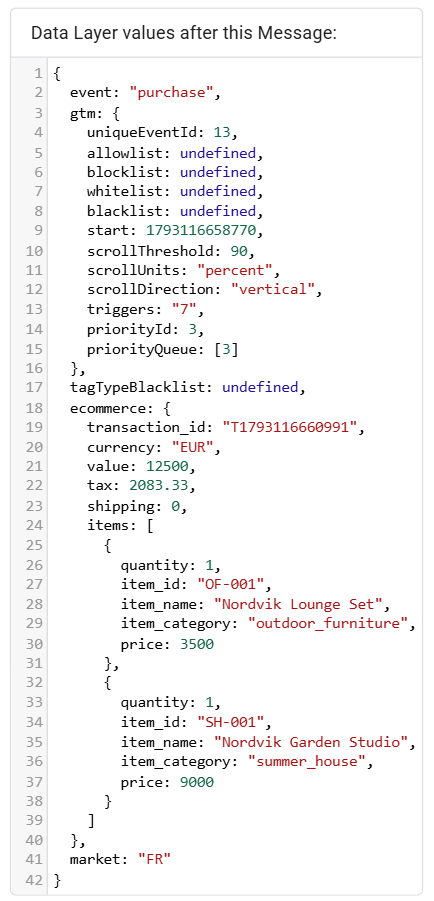
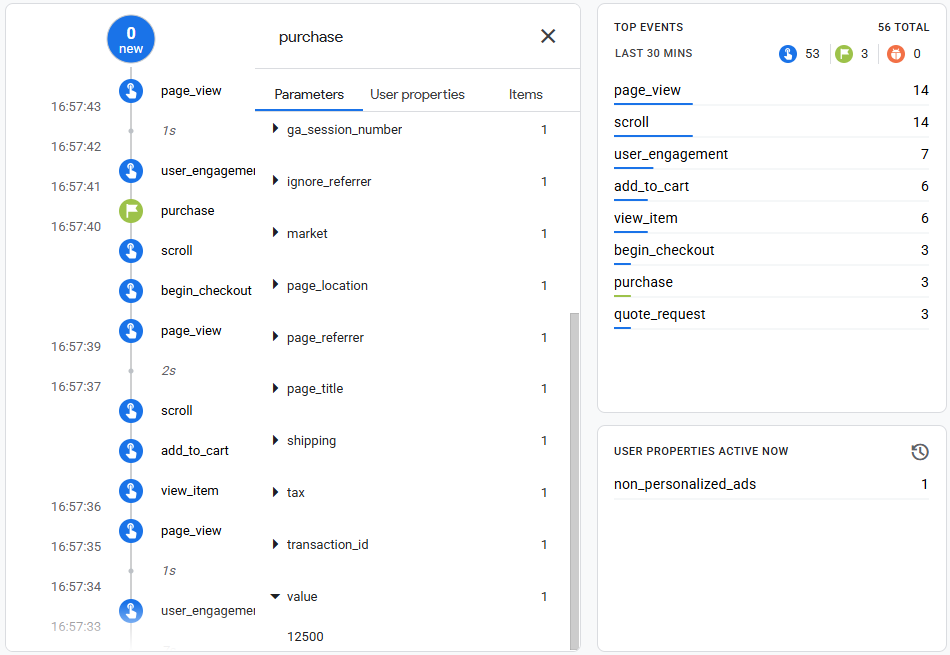
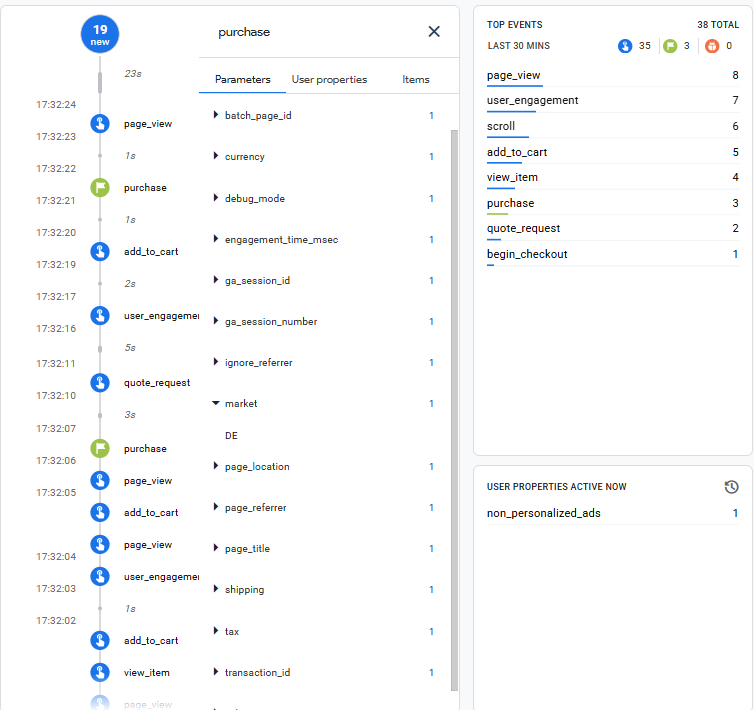
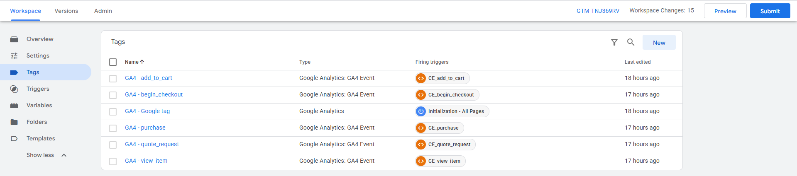
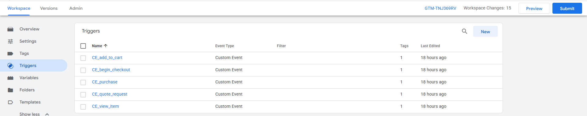
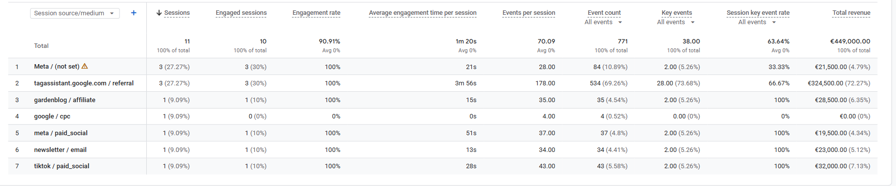
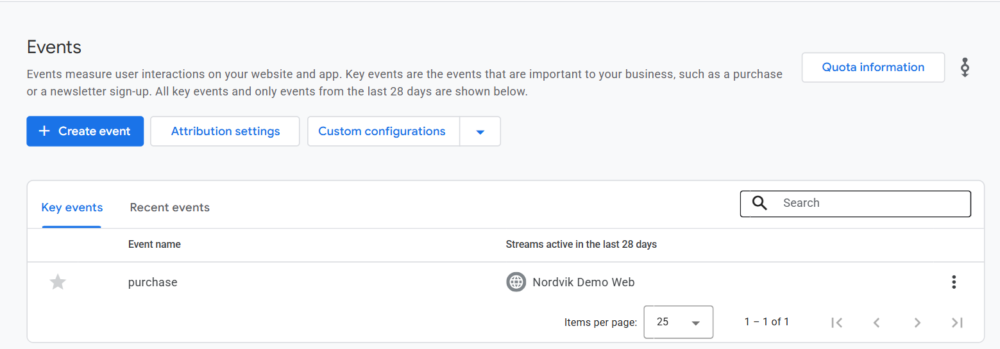
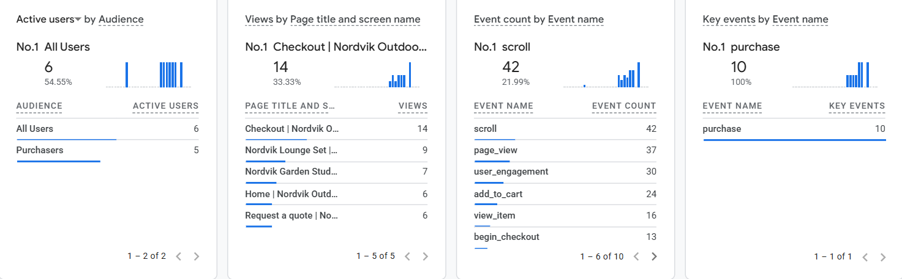

# Nordvik Tracking Demo

A small demo shop used to practise a **GTM + GA4 tracking implementation**: data layer events, UTM tests and event validation. **Fictional brand. No real products, prices, orders or customers, and no personal data.**

Live site: https://yvettedzs.github.io/nordvik-tracking-demo/

## What I built
- A five-page demo shop (home, two product pages, checkout, quote form) with a **market selector** (DE, AT, FR, NL, UK, SE).
- A **Google Tag Manager container** and a **GA4 property**. Events are pushed to the data layer using GA4's recommended e-commerce names.
- Five custom events, each with its own GTM trigger and GA4 event tag:

| Event | When it fires | Key parameters |
|---|---|---|
| `view_item` | Product page loads | `items`, `value`, `market` |
| `add_to_cart` | Add to cart clicked | `items`, `value`, `market` |
| `begin_checkout` | Checkout page loads | `items`, `value`, `market` |
| `purchase` | Test order placed | `transaction_id`, `value`, `tax`, `items`, `market` |
| `quote_request` | Quote form submitted | `product_interest`, `market` |

- A UTM naming convention and six test links. See [`docs/tracking_plan.md`](docs/tracking_plan.md) and [`docs/gtm_setup_guide.md`](docs/gtm_setup_guide.md).

## Evidence
**1. The event reaches GTM and the tag fires** (Tag Assistant Preview mode)

**2. The `market` parameter is mapped into the tag**

**3. The data layer carries a complete e-commerce object** (`transaction_id`, `value`, `tax`, `items`, `market`)

**4. The data arrives in GA4** (DebugView)

**5. The container set-up: six tags and five triggers**

**6. UTM test results** (GA4, Traffic acquisition by session source / medium)

**7. `purchase` recognised as a key event, and live traffic in Realtime**

## What the tests showed
- The five clean test links each arrived with the intended source and medium (`google / cpc`, `meta / paid_social`, `tiktok / paid_social`, `gardenblog / affiliate`, `newsletter / email`).
- **A deliberately broken link** (capital letter, space, missing medium) was recorded as a separate `Meta / (not set)` row, so one channel split into two. This is the kind of error a tracking-quality check should catch.
- **My own Preview-mode traffic** appeared as a `tagassistant.google.com / referral` source and carried most of the test events and revenue. In a real property, internal and test traffic like this has to be excluded or flagged.

## What is real and what is not
- **Real:** the GTM container, the GA4 property, the data layer events and parameters, and the test traffic I generated.
- **Not real:** the company, products, prices, orders and customers. The revenue figures in GA4 are made-up test orders.
- **Not covered:** consent handling, ad-platform pixels, conversion APIs and server-side GTM. These are not part of this demo.

## Status
In progress: a server-side `purchase` event through the GA4 Measurement Protocol and SQL data-quality checks in BigQuery.

Related project (simulated marketing measurement and incrementality): https://github.com/yvettedzs/nordvik-marketing-measurement

